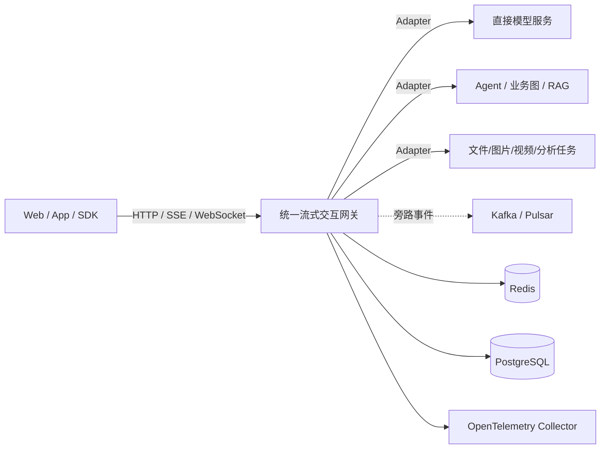
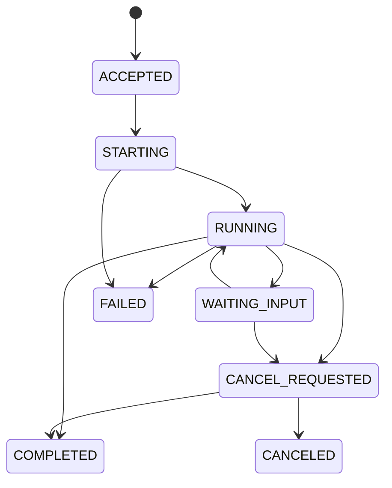

# 统一流式交互网关：需求澄清文档

> 文档状态：基线草案（Baseline Draft）  
> 文档日期：2026-07-27  
> 目标读者：产品负责人、架构师、后端开发、客户端开发、测试、SRE、安全团队、Codex 代码智能体  
> 首期工程基线：Java 21 + Quarkus；核心协议、领域模型与验收标准必须保持语言无关  
> 规范关键词：**MUST / MUST NOT / SHOULD / SHOULD NOT / MAY** 分别表示必须、禁止、建议、不建议、可选

---

## 1. 文档目的

本文档用于在编码开始前冻结项目的业务边界、核心概念、功能要求、非功能要求、验收标准和禁止事项，避免在使用 Codex 搭建项目、生成代码和持续迭代时发生以下偏移：

1. 把系统误做成单纯的模型代理或 OpenAI API 兼容网关；
2. 把 SSE/WebSocket 误当成业务模型，而没有统一事件语义；
3. 把下游 Agent、RAG、业务图和 Prompt 逻辑搬进网关；
4. 重新形成“一个会话线程承担网络、上下文、日志、Redis、持久化和业务处理”的结构；
5. 使用无界队列、无界并发、同步副作用或阻塞 Event Loop；
6. 为追求所谓“通用性”而提前建设过度复杂的编排平台；
7. 在没有压测和可观测性证据的情况下，以语言重写替代架构治理。

本文档是需求基线。任何与本文档冲突的实现，必须先通过 ADR（Architecture Decision Record）说明原因、替代方案、影响和回滚方式，再修改本文档。

---

## 2. 项目定义

### 2.1 项目暂定名称

**统一流式交互网关（Unified Streaming Interaction Gateway，USIG）**

### 2.2 一句话定义

面向模型、智能体、RAG、工作流和其他长任务服务，提供统一接入、会话与任务映射、流式协议适配、事件标准化、安全治理、可靠传输、取消与恢复、多端输出和可观测性的一体化中间层。

### 2.3 核心价值

网关统一的是：

- 接入方式；
- 传输协议；
- 执行生命周期；
- 事件格式；
- 错误语义；
- 安全策略；
- 可靠性边界；
- 客户端消费模型；
- 可观测性。

网关**不统一**：

- 下游业务图；
- Prompt；
- RAG 检索策略；
- Agent Memory；
- 模型内部参数策略；
- 工具具体实现；
- 行业业务规则；
- 下游 Checkpoint；
- 下游领域数据模型。

核心原则：

> **统一交互，不统一业务；统一事件，不复制下游状态。**

---

## 3. 背景与问题陈述

现有版本采用 Java 21、Netty、Reactive 和虚拟线程管理上游与下游两条 SSE 流，并在同一个会话执行单元中承担：

- 下游 SSE 建连与读取；
- 内容解析；
- 上下文处理；
- 敏感信息擦除；
- 客户端格式化；
- 下游 SSE 输出；
- 日志构建；
- 异步调用保存服务；
- Redis 会话信息维护；
- 连接保活、异常和清理。

当前风险不只来自 Java 或线程模型，而来自职责聚合和缺乏明确资源边界：

- 单个 Run 的热路径包含过多副作用；
- 阻塞调用可能进入 I/O 线程；
- 缓冲策略、慢客户端策略和背压边界不清晰；
- 下游协议差异不断侵入主流程；
- SSE Chunk 被当作业务事件，难以支持工具、图节点、产物、审批和长任务；
- Redis、数据库和日志写入容易放大延迟；
- 断线后“已观察、已发送、已持久化”状态缺乏清晰区分；
- App 与 Web 的显示协议容易随着下游服务变化而分叉。

---

## 4. 目标与非目标

## 4.1 业务目标

| ID | 目标 |
|---|---|
| BG-001 | 一套网关能够通过可插拔 Adapter 接入直接模型、智能体/业务图、RAG、工作流和通用流式服务。 |
| BG-002 | App、Web 和未来 SDK 使用同一套客户端事件协议，不感知下游服务实现。 |
| BG-003 | 允许下游保留自己的状态图、Memory、Checkpoint 和业务逻辑。 |
| BG-004 | 在需求变化时，优先新增 Adapter、Pipeline Stage 或事件类型，而不是修改核心运行时。 |
| BG-005 | 通过明确的容量、缓冲、超时、取消、恢复和降级策略提高服务可靠性。 |
| BG-006 | 支持通过 Codex 分阶段搭建工程，并通过文档、测试和架构守卫防止方向偏移。 |

## 4.2 技术目标

| ID | 目标 |
|---|---|
| TG-001 | 核心运行时使用事件驱动、非阻塞 I/O 和有界资源模型。 |
| TG-002 | 每个 Run 是轻量状态对象，不与独占平台线程或虚拟线程一一绑定。 |
| TG-003 | 主数据流只执行必要的解析、标准化、策略和投影；日志、审计和持久化尽可能旁路。 |
| TG-004 | 保证同一 Run 内事件有序；跨 Run 不提供全局顺序。 |
| TG-005 | 断线重连采用“至少一次补发 + 客户端按 eventId 去重”，不承诺 Exactly Once。 |
| TG-006 | 能够通过压测量化 Java/Quarkus 与未来 Rust 数据平面的差异。 |

## 4.3 明确非目标

首期 MUST NOT 实现：

1. 通用可视化 Agent 编排器；
2. 在网关内部执行行业业务图；
3. 全量复制下游 Agent Memory 或 Checkpoint；
4. 通用 Prompt 管理平台；
5. 通用向量数据库/RAG 平台；
6. 复杂模型训练、推理调度或 GPU 资源管理；
7. 每个 Token 的永久可靠存储；
8. 跨地域强一致性；
9. Exactly Once 流式投递；
10. 仅为“可能需要”而引入多微服务拆分；
11. 同时实现 Java 和 Rust 两套生产运行时；
12. 让任意外部服务通过配置直接执行任意脚本或表达式。

---

## 5. 核心术语

| 术语 | 定义 |
|---|---|
| Conversation | 用户视角的一段持续对话或交互上下文，可包含多个 Run。 |
| Run | 一次可追踪、可取消、可结束的执行；直接模型调用也必须抽象为 Run。 |
| Task | 下游服务持有的长任务标识；并非所有下游都有 Task。 |
| ExecutionHandle | 网关用于查询、取消或恢复下游执行的句柄，包含 serviceId、taskId、threadId 等不透明字段。 |
| GatewayEvent | 网关内部统一事件，是系统核心业务抽象。 |
| RawFrame | SSE、WebSocket、HTTP Chunk 或 gRPC 流的原始传输帧。 |
| Adapter | 将统一请求转换为下游请求，并把下游帧/事件转换为 GatewayEvent 的组件。 |
| Pipeline Stage | 对 GatewayEvent 执行排序、聚合、脱敏、权限、投影等处理的可组合阶段。 |
| Projection | 将内部 GatewayEvent 转换成某个客户端或协议所需事件。 |
| StreamCursor | 用于续传或补发的游标；首期以 sequence/eventId 表示。 |
| RunSession | 某个 Run 的轻量运行时状态，不等同于线程。 |
| Control Plane | 创建、查询、取消、恢复、路由、能力管理等低频控制操作。 |
| Data Plane | 高频流式事件的读取、转换、策略执行和输出。 |

---

## 6. 参与方与使用场景

### 6.1 参与方

- 最终用户；
- Web/App/桌面客户端；
- 客户端 SDK；
- 网关管理者；
- 模型服务；
- 智能体/业务图服务；
- RAG 和工作流服务；
- 文件、图片、视频、代码执行等长任务服务；
- 日志、审计、计费、持久化服务；
- SRE 和安全团队。

### 6.2 主要场景

#### UC-001：直接模型流式对话

客户端提交文本和图片输入，网关选择模型 Adapter，调用 OpenAI-compatible、Qwen、DeepSeek、vLLM 或其他模型端点，把模型 Chunk 转换为统一 `text.delta`、`reasoning.delta`、`usage` 和生命周期事件。

#### UC-002：有状态 Agent/业务图

客户端发起 Run，网关调用具有自己 Task、Thread、Graph、RAG 和工具状态的服务。网关只维护本地 Run 与下游句柄映射，并转换文本、节点、工具、产物、等待输入和错误事件。

#### UC-003：通用长任务服务

文件解析、图片/视频生成、数据分析等服务通过 SSE/WebSocket 输出进度和产物。网关将其标准化为 `execution.*`、`progress.updated`、`artifact.*` 等事件。

#### UC-004：客户端断线恢复

客户端使用 `Last-Event-ID` 或显式 cursor 重新连接。网关从短期 Replay Buffer 补发；若下游支持恢复，则重新订阅下游；若无法恢复，返回明确的 `stream_not_resumable`，不得伪造完整性。

#### UC-005：用户取消

客户端取消 Run。网关立即停止向客户端继续发送普通业务事件，并尽力向下游传播取消。最终状态必须区分：`cancel_requested`、`canceled`、`cancel_not_supported` 和 `completed_before_cancel`。

#### UC-006：智能体要求输入/审批

下游发送 `input.required` 或 `approval.required`。SSE 模式下客户端通过独立 HTTP 接口提交；WebSocket 模式可通过同一连接提交。网关不得替下游决定业务审批结果。

---

## 7. 系统边界



### 7.1 网关拥有的状态

网关 MAY 保存：

- conversationId、runId；
- tenantId、userId；
- serviceId、adapterId；
- 下游 taskId/threadId/runId 等不透明映射；
- 执行生命周期；
- lastEmittedSequence、lastEventId；
- 取消状态；
- 恢复能力；
- 短期 Replay Buffer；
- 最终结果摘要、统计、审计索引。

### 7.2 下游服务拥有的状态

网关 MUST NOT 复制或修改：

- 下游业务图完整 State；
- 下游 Agent Memory；
- 下游 Checkpoint；
- 下游工具内部状态；
- 下游 Prompt 细节；
- 下游模型选择逻辑；
- 下游领域事务。

---

## 8. 功能需求

## 8.1 接入 API

| ID | 要求 | 优先级 |
|---|---|---|
| FR-API-001 | MUST 提供创建 Run 的 HTTP API。 | P0 |
| FR-API-002 | MUST 提供查询 Run 状态的 HTTP API。 | P0 |
| FR-API-003 | MUST 提供 SSE 订阅 Run 事件的 API。 | P0 |
| FR-API-004 | MUST 提供取消 Run 的 API。 | P0 |
| FR-API-005 | MUST 提供提交用户补充输入/审批结果的 API。 | P1 |
| FR-API-006 | SHOULD 提供 WebSocket 双向实时端点。首期可以在 SSE 稳定后实现。 | P1 |
| FR-API-007 | MUST 对外版本化，首期使用 `/v1`。 | P0 |
| FR-API-008 | MUST 使用统一错误结构，禁止直接透传下游异常堆栈。 | P0 |

推荐外部接口：

```text
POST   /v1/conversations
POST   /v1/runs
GET    /v1/runs/{runId}
GET    /v1/runs/{runId}/events
POST   /v1/runs/{runId}:cancel
POST   /v1/runs/{runId}:input
GET    /v1/services/{serviceId}/capabilities
WS     /v1/realtime
```

## 8.2 服务注册与能力声明

| ID | 要求 |
|---|---|
| FR-SVC-001 | 每个下游必须有稳定 `serviceId`、`serviceType`、endpoint、adapterId 和租户可见范围。 |
| FR-SVC-002 | 每个下游必须声明 transports、streaming、cancel、resume、replay、taskQuery、multimodalInput、humanInput、structuredOutput 等能力。 |
| FR-SVC-003 | 网关 MUST 根据能力决定行为，不得假设所有服务都支持取消和恢复。 |
| FR-SVC-004 | 服务配置变更 MUST 可审计，并支持版本号。 |
| FR-SVC-005 | 首期服务注册可使用静态配置或数据库，不要求服务发现平台。 |

能力示例：

```json
{
  "serviceId": "finance-agent",
  "serviceType": "agent",
  "adapterId": "legacy-agent-sse-v1",
  "transports": ["sse"],
  "capabilities": {
    "streaming": true,
    "cancel": true,
    "resume": true,
    "replay": false,
    "taskQuery": true,
    "humanInput": true,
    "multimodalInput": true,
    "structuredOutput": true
  }
}
```

## 8.3 Adapter

| ID | 要求 |
|---|---|
| FR-ADP-001 | 所有下游接入必须通过 Adapter SPI，核心运行时不得包含 serviceId 分支判断。 |
| FR-ADP-002 | Adapter 必须完成请求映射、认证头注入、下游调用、事件解析、错误映射和取消/恢复能力实现。 |
| FR-ADP-003 | Adapter 输出必须是 GatewayEvent，禁止把 RawFrame 直接交给客户端。 |
| FR-ADP-004 | Adapter 不得包含客户端 UI 格式。 |
| FR-ADP-005 | Adapter 必须有契约测试，覆盖正常、分片、乱码、非法 JSON、超长帧、超时、半关闭和取消。 |
| FR-ADP-006 | 首期必须实现 Generic SSE JSON Adapter 和一个真实业务 Adapter。OpenAI-compatible Adapter 可作为第二个样例。 |

## 8.4 统一事件模型

GatewayEvent MUST 至少包含：

```json
{
  "schemaVersion": "1.0",
  "eventId": "evt_01J...",
  "eventType": "text.delta",
  "conversationId": "conv_01J...",
  "runId": "run_01J...",
  "taskId": "optional-downstream-task-id",
  "sourceService": "finance-agent",
  "sourceEventId": "optional-source-id",
  "sequence": 128,
  "occurredAt": "2026-07-27T10:30:00+09:00",
  "observedAt": "2026-07-27T10:30:00.015+09:00",
  "payload": {},
  "metadata": {
    "tenantId": "tenant_01",
    "traceId": "..."
  }
}
```

事件类别 P0：

```text
execution.accepted
execution.started
execution.running
execution.completed
execution.failed
execution.cancel_requested
execution.canceled

text.start
text.delta
text.end

tool.start
tool.arguments.delta
tool.result
tool.error
tool.end

artifact.created
artifact.updated
artifact.completed

input.required
approval.required

progress.updated
usage.updated
warning
heartbeat
```

事件规则：

| ID | 要求 |
|---|---|
| FR-EVT-001 | 同一 Run 的 `sequence` MUST 单调递增，不要求连续。 |
| FR-EVT-002 | `eventId` MUST 全局唯一；重放同一事件时保持相同 eventId。 |
| FR-EVT-003 | `sourceEventId` 若存在必须保留，便于下游去重和排障。 |
| FR-EVT-004 | `text.delta` 只表达增量文本，不承载完整会话状态。 |
| FR-EVT-005 | 终止事件后不得再发送普通业务事件；只允许发送连接级诊断。 |
| FR-EVT-006 | 未知事件类型必须可透传为 `extension.*` 或被明确忽略，不得导致进程崩溃。 |
| FR-EVT-007 | schemaVersion 使用 Major.Minor；破坏性变更必须升级 Major。 |
| FR-EVT-008 | 事件信封设计应参考 CloudEvents 的 id/source/type/time 分离思想，但不要求对客户端完全实现 CloudEvents。 |

## 8.5 Pipeline

| ID | 要求 |
|---|---|
| FR-PIPE-001 | Pipeline 必须由可组合 Stage 构成。 |
| FR-PIPE-002 | Stage 必须声明是否同步、是否可能阻塞、是否改变顺序、是否可丢弃事件。 |
| FR-PIPE-003 | 核心 Pipeline 必须包含：验证、序号、聚合、脱敏、策略、投影、可观测性。 |
| FR-PIPE-004 | Stage 默认不得访问数据库。需要持久化时通过旁路事件或专用异步接口。 |
| FR-PIPE-005 | 任一 Stage 的最大执行时间和错误策略必须可配置。 |
| FR-PIPE-006 | 不同服务可选择不同 Pipeline Profile，但所有 Profile 必须输出同一 GatewayEvent 规范。 |

## 8.6 Run 生命周期



| ID | 要求 |
|---|---|
| FR-RUN-001 | 状态变更必须使用 CAS/乐观锁或单写者机制，禁止无保护的多线程修改。 |
| FR-RUN-002 | Run 创建必须支持 idempotencyKey。 |
| FR-RUN-003 | 同一 idempotencyKey、租户和业务作用域内，重复创建必须返回同一 Run 或明确冲突。 |
| FR-RUN-004 | 网关重启后至少能查询已创建 Run 的最终/未知状态。 |
| FR-RUN-005 | 活跃 Run 的短期运行时对象可丢失，但必须通过下游查询或明确失败恢复，不得伪造。 |

## 8.7 SSE

| ID | 要求 |
|---|---|
| FR-SSE-001 | SSE 是单请求持续输出场景的默认客户端传输。 |
| FR-SSE-002 | 每个业务事件必须设置 SSE `id`，值为 GatewayEvent.eventId。 |
| FR-SSE-003 | SSE `event` 使用 GatewayEvent.eventType。 |
| FR-SSE-004 | 必须支持 `Last-Event-ID` 或等价 cursor。 |
| FR-SSE-005 | 必须配置心跳，默认 15 秒；代理环境允许调整。 |
| FR-SSE-006 | 必须设置禁止代理缓冲所需的响应头或部署配置。 |
| FR-SSE-007 | 客户端断开必须触发订阅清理，但是否取消下游由 Run 策略决定。 |
| FR-SSE-008 | SSE 连接不得持有数据库事务。 |
| FR-SSE-009 | 单帧和单事件大小必须有上限；默认建议 256 KiB。 |

## 8.8 WebSocket

| ID | 要求 |
|---|---|
| FR-WS-001 | 只有真正需要双向持续交互、实时音视频或单连接多任务时才使用 WebSocket。 |
| FR-WS-002 | WebSocket 必须定义子协议，如 `usig.events.v1`。 |
| FR-WS-003 | WebSocket 消息仍使用 GatewayEvent/Command，不得另建完全不同的业务语义。 |
| FR-WS-004 | 必须限制 Origin、使用 WSS、限制帧大小并处理鉴权续期。 |
| FR-WS-005 | 多 Run 复用一个连接时，每条消息必须包含 runId。 |
| FR-WS-006 | 首期不要求客户端 ACK 每个 text.delta；关键控制命令必须有 commandId 和响应。 |

## 8.9 背压与有界资源

| ID | 要求 |
|---|---|
| FR-BP-001 | 所有队列、缓冲区、并发数和重试次数必须有界。 |
| FR-BP-002 | 每个 Run 必须配置最大事件数和最大待发送字节数。 |
| FR-BP-003 | 慢客户端策略必须可选：暂停上游、聚合、丢弃低价值事件、转后台或断开。 |
| FR-BP-004 | 不可丢事件和可压缩事件必须明确分类。 |
| FR-BP-005 | 相邻 `text.delta` SHOULD 在 10–30ms 或达到大小阈值时合并。 |
| FR-BP-006 | 默认禁止使用无界 Processor/Emitter/Queue。 |
| FR-BP-007 | 当容量耗尽时必须快速拒绝或降级，不得通过不断增加线程和内存维持表面成功。 |

不可丢事件：

```text
execution.started
text.end
tool.result
artifact.completed
input.required
approval.required
execution.failed
execution.completed
execution.canceled
```

可聚合/可丢弃事件：

```text
text.delta（可聚合，不建议丢弃）
reasoning.delta（可聚合或按策略隐藏）
progress.updated（可覆盖旧值）
heartbeat（可丢弃）
typing（可丢弃）
```

## 8.10 取消、超时和重试

| ID | 要求 |
|---|---|
| FR-RES-001 | 必须区分连接超时、首事件超时、事件空闲超时、总执行超时和取消超时。 |
| FR-RES-002 | 创建请求只可在确认幂等时重试。已开始流式输出后不得盲目重试整个 Run。 |
| FR-RES-003 | Adapter 必须声明重试安全级别。 |
| FR-RES-004 | 取消是尽力而为，必须输出最终可验证状态。 |
| FR-RES-005 | 下游断流时，如果支持 resume 则续订；否则以明确错误结束。 |
| FR-RES-006 | 熔断和并发隔离必须按 serviceId 或 serviceGroup 生效，禁止一个下游拖垮全局。 |

## 8.11 短期重放与恢复

| ID | 要求 |
|---|---|
| FR-RPL-001 | 网关必须提供短期 Replay Buffer，默认 TTL 10 分钟，可按服务配置。 |
| FR-RPL-002 | Replay Buffer 必须有单 Run 字节上限和租户总上限。 |
| FR-RPL-003 | 续传语义为至少一次；客户端必须按 eventId 去重。 |
| FR-RPL-004 | 如果 cursor 早于可重放窗口，返回 `cursor_expired`。 |
| FR-RPL-005 | 不得把短期重放当作永久消息存储。 |

## 8.12 图片与多模态输入

| ID | 要求 |
|---|---|
| FR-MM-001 | Run 请求必须支持文本与图片引用。 |
| FR-MM-002 | 大文件不得直接通过 JSON Base64 长期传递；首期使用对象存储 URL 或上传凭证。 |
| FR-MM-003 | 网关负责鉴权、大小/MIME 校验和引用转换，不负责图片内容业务理解。 |
| FR-MM-004 | 下游不支持多模态时必须在执行前拒绝。 |

## 8.13 旁路事件与持久化

| ID | 要求 |
|---|---|
| FR-SIDE-001 | 日志、审计、计费、分析和非关键消息持久化 SHOULD 通过旁路事件处理。 |
| FR-SIDE-002 | 旁路失败默认不得阻塞 text.delta；关键审计失败策略必须按租户配置。 |
| FR-SIDE-003 | 旁路消息必须包含 eventId、runId、tenantId 和 traceId。 |
| FR-SIDE-004 | 不要求每个 Token 持久化；可使用合并后的文本块或最终消息。 |
| FR-SIDE-005 | 使用 Kafka 时必须明确消息键、分区、确认和重复消费策略。 |

---

## 9. 非功能需求

## 9.1 性能和容量验收基线

以下是首期工程验收目标，不是对所有生产环境的永久承诺。压测基准节点：**8 vCPU、16 GiB 内存、Linux、同地域下游模拟器**。

| ID | 指标 | 首期目标 |
|---|---|---|
| NFR-PERF-001 | 主要空闲 SSE 长连接 | 单实例稳定维持 10,000 连接 30 分钟，无 OOM、无持续 Full GC。 |
| NFR-PERF-002 | 活跃流吞吐 | 2,000 活跃 Run × 平均 10 event/s，即 20,000 event/s。 |
| NFR-PERF-003 | 网关新增延迟 | 在目标负载下，`observedAt → emittedAt` P99 ≤ 100ms；正常负载 P99 ≤ 30ms。 |
| NFR-PERF-004 | 错误率 | 非故障注入时网关自身 5xx/异常断流率 < 0.1%。 |
| NFR-PERF-005 | 慢客户端隔离 | 1% 客户端限速至 1 event/s 时，其他 Run 的 P99 延迟劣化不超过 20%。 |
| NFR-PERF-006 | 内存保护 | 达到配置容量后快速拒绝或降级，不得出现无界增长。 |
| NFR-PERF-007 | 泄漏检查 | 10,000 次建连/断连循环后，连接、订阅和 RunSession 数回落到基线 ±2%。 |

## 9.2 可用性和恢复

| ID | 要求 |
|---|---|
| NFR-REL-001 | 生产目标可用性不低于 99.9%，最终以部署拓扑和依赖 SLA 为准。 |
| NFR-REL-002 | 单实例异常不得导致已持久化 Run 元数据丢失。 |
| NFR-REL-003 | 网关滚动发布时，新请求可继续；旧连接允许优雅排空。 |
| NFR-REL-004 | 优雅关闭必须停止接收新 Run、等待配置时间、取消或转移剩余连接。 |
| NFR-REL-005 | Redis、Kafka、数据库分别故障时必须有明确降级矩阵。 |

## 9.3 安全

| ID | 要求 |
|---|---|
| NFR-SEC-001 | 所有外部连接使用 TLS；WebSocket 使用 WSS。 |
| NFR-SEC-002 | 所有请求必须建立 tenantId/userId/subject 上下文。 |
| NFR-SEC-003 | serviceId、runId、conversationId 查询必须执行租户隔离校验。 |
| NFR-SEC-004 | 日志、Trace、Metrics 标签不得包含正文、Token、密钥和高敏个人信息。 |
| NFR-SEC-005 | 敏感信息擦除必须支持跨 Chunk 滚动窗口。 |
| NFR-SEC-006 | 下游凭证必须使用 Secret 管理，不写入配置库和日志。 |
| NFR-SEC-007 | WebSocket 必须限制 Origin，并在握手和会话期间处理身份过期。 |
| NFR-SEC-008 | 通用 Adapter 不得允许任意 URL SSRF；下游必须来自白名单注册表。 |
| NFR-SEC-009 | 图片/文件 URL 必须限制协议、域名、大小、超时和重定向次数。 |

## 9.4 可观测性

必须使用 OpenTelemetry 语义组织 Trace、Metric、Log：

- 一个 Run 至少一个根 Span；
- 下游调用、恢复、取消、关键 Stage 建立子 Span；
- 日志必须结构化并关联 traceId/runId；
- Metrics 必须限制标签基数，禁止把 runId/userId 作为常规指标标签。

P0 指标：

```text
usig_active_connections
usig_active_runs
usig_events_in_total
usig_events_out_total
usig_event_transform_duration
usig_stream_added_latency
usig_buffer_bytes
usig_buffer_overflow_total
usig_replay_hit_total
usig_replay_miss_total
usig_downstream_errors_total
usig_cancel_total
usig_resume_total
usig_run_duration
usig_first_event_latency
```

## 9.5 可维护性

| ID | 要求 |
|---|---|
| NFR-MNT-001 | 核心领域模块不得依赖 Quarkus、Redis、Kafka 或具体 HTTP 客户端。 |
| NFR-MNT-002 | 使用 ArchUnit 或等价机制验证包/模块依赖方向。 |
| NFR-MNT-003 | 每个 Adapter 必须有独立 README、能力说明和契约测试。 |
| NFR-MNT-004 | 每个破坏性协议变更必须有迁移说明。 |
| NFR-MNT-005 | 公共接口必须有 JavaDoc/OpenAPI/AsyncAPI 或 Markdown 契约。 |

---

## 10. 数据一致性和交付语义

1. 实时链路在正常连接中保证同一 Run 的有序转发；
2. 重连和补发采用至少一次；
3. 客户端使用 `eventId` 去重；
4. `sequence` 用于排序和发现缺口，不作为全局唯一 ID；
5. 网关不承诺下游业务状态与已发送事件同步提交；
6. 必须区分：
   - `observed`：网关已收到；
   - `emitted`：网关已写入客户端连接；
   - `acknowledged`：客户端已确认，仅 WebSocket 控制消息可选；
   - `committed`：下游或持久化服务确认状态已保存。

---

## 11. 默认技术决策（首期冻结）

| ID | 决策 |
|---|---|
| DEC-001 | 首期使用 Java 21 + Quarkus 构建模块化单体。 |
| DEC-002 | Quarkus 平台版本在项目初始化时固定到 BOM；本文档日期的可用基线为 3.37.4。 |
| DEC-003 | SSE 为 P0，WebSocket 为 P1。 |
| DEC-004 | 核心领域模型语言无关，JSON Schema 作为事件契约来源之一。 |
| DEC-005 | Redis 保存活跃 Run 映射、短期游标和 Replay Buffer；PostgreSQL 保存持久元数据。 |
| DEC-006 | Kafka/消息队列用于旁路事件，首期允许用 In-Memory 实现替代以完成骨架。 |
| DEC-007 | 首期不拆分为多个独立微服务。 |
| DEC-008 | 首期不引入 Temporal/Restate 处理 Token 热流；未来只用于长任务控制平面。 |
| DEC-009 | 首期实现 Generic SSE Adapter + 一个真实业务 Adapter。 |
| DEC-010 | Rust 只作为后续同契约数据平面 PoC，不与 Java 首期并行开发。 |

---

## 12. 验收标准

### 12.1 功能验收

- [ ] 可以创建 Run 并获得 runId；
- [ ] 可以通过 SSE 接收统一事件；
- [ ] 可以接入至少两个语义不同的下游服务；
- [ ] 客户端事件中不出现下游私有协议字段；
- [ ] 可以取消支持取消的下游；
- [ ] 对不支持取消的下游返回明确状态；
- [ ] 支持 Last-Event-ID 补发；
- [ ] cursor 过期时返回明确错误；
- [ ] 支持图片引用输入；
- [ ] 敏感信息跨 Chunk 被正确擦除；
- [ ] 慢客户端不会导致全局内存无限增长；
- [ ] 下游异常被转换为稳定错误码；
- [ ] 日志、Trace、Metrics 可按 runId/traceId 关联。

### 12.2 工程验收

- [ ] 所有队列和并发配置可检索到上限；
- [ ] Event Loop 阻塞检测测试通过；
- [ ] ArchUnit 依赖规则通过；
- [ ] Adapter 契约测试通过；
- [ ] SSE 拆包/粘包/多行 data 测试通过；
- [ ] 连接泄漏测试通过；
- [ ] 故障注入测试覆盖下游断流、超时、Redis 不可用、慢客户端；
- [ ] 性能基线达到第 9.1 节目标或记录经批准的偏差。

---

## 13. Codex 方向控制规则

以下规则必须复制到仓库根目录 `AGENTS.md` 或被其引用。Codex 官方说明支持通过仓库中的 `AGENTS.md` 提供代码组织、测试命令和项目规范。

### 13.1 Codex MUST

1. 开始任务前阅读本文档和架构设计文档；
2. 只实现当前任务明确要求的范围；
3. 为公共 API、事件和状态变更添加测试；
4. 在修改核心契约前创建或更新 ADR；
5. 运行单元测试、集成测试、格式检查和架构测试；
6. 在提交结果中说明：修改文件、设计依据、测试结果、未解决问题；
7. 遵守模块依赖方向；
8. 使用有界缓冲、显式超时和显式并发限制；
9. 将阻塞调用隔离到受限 Worker/虚拟线程池；
10. 对所有下游输入进行大小、格式和超时校验。

### 13.2 Codex MUST NOT

1. 不得新建“万能 Service”或超过约 300 行且职责混杂的核心类；
2. 不得在核心模块引入 Quarkus、Vert.x、Redis、Kafka 类；
3. 不得在 Transport 层写模型/Agent 业务判断；
4. 不得在 Adapter 中写客户端 UI 投影；
5. 不得使用无界 `Queue`、无界 `Emitter` 或 `Long.MAX_VALUE` 需求作为默认策略；
6. 不得在 Event Loop 中执行 JDBC、文件 I/O、阻塞 HTTP 或同步远程调用；
7. 不得把正文、密钥和敏感字段放入 Metrics 标签；
8. 不得把每个 Token 同步写 Redis/数据库；
9. 不得未经需求批准增加 Kubernetes、服务网格、Temporal、Restate 等基础设施；
10. 不得为了减少代码量绕过 Adapter、GatewayEvent 或 Pipeline。

### 13.3 Codex 任务拆分要求

每个任务必须满足：

- 一个明确目标；
- 一组允许修改的目录；
- 一组禁止修改的目录；
- 可执行测试命令；
- 完成定义；
- 回滚方式。

禁止把“搭建整个项目”作为一个无边界任务。建议按架构文档的阶段逐项执行。

---

## 14. 待业务方最终确认的问题

这些问题不阻止搭建骨架，但进入生产前必须明确：

1. 生产峰值并发 Run、空闲连接和 event/s 分别是多少；
2. Replay Buffer 需要 5 分钟、10 分钟还是更长；
3. 客户端断开是否默认继续下游任务；
4. 哪些租户要求关键审计失败即阻断输出；
5. 是否允许展示 reasoning 事件；
6. 图片输入最大大小、存储方式和保留周期；
7. Run 元数据和最终消息的保留周期；
8. 哪些服务需要 WebSocket；
9. 是否需要跨设备同时订阅一个 Run；
10. 服务路由是由客户端指定、业务配置指定还是动态策略选择。

默认假设：客户端断开不自动取消下游；reasoning 默认不对客户端输出；Replay TTL 10 分钟；服务路由由受控配置决定，客户端不能任意指定 URL。

---

## 15. 参考来源

1. AG-UI：Agent 与用户界面的事件协议，支持 SSE、WebSocket 等传输：  
   https://github.com/ag-ui-protocol/ag-ui
2. A2A：独立、内部不透明 Agent 间的能力发现、任务、SSE 流和长任务协议：  
   https://github.com/a2aproject/A2A  
   https://github.com/a2aproject/A2A/blob/main/docs/specification.md
3. CloudEvents：事件数据与传输消息分离、统一事件上下文的参考：  
   https://github.com/cloudevents/spec
4. Quarkus REST SSE：  
   https://quarkus.io/guides/rest
5. Quarkus WebSockets Next：  
   https://quarkus.io/guides/websockets-next-reference
6. Mutiny：流、线程切换、背压和有界队列注意事项：  
   https://smallrye.io/smallrye-mutiny/latest/
7. Quarkus Messaging：旁路事件、顺序、并发和 OpenTelemetry 集成：  
   https://quarkus.io/guides/messaging
8. OpenTelemetry Signals：  
   https://opentelemetry.io/docs/concepts/signals/
9. OpenAI Codex 与 AGENTS.md：  
   https://openai.com/index/introducing-codex/

---

## 16. 变更控制

本文档发生以下变更时必须新增 ADR：

- 改变 GatewayEvent 信封或投递语义；
- 改变 Run 状态机；
- 引入新的永久存储或消息系统；
- 将模块化单体拆为微服务；
- 把 Java 数据平面替换为 Rust；
- 改变 SSE/WebSocket 的职责边界；
- 允许网关执行下游业务图；
- 改变至少一次补发语义；
- 引入无界资源或全局锁。
