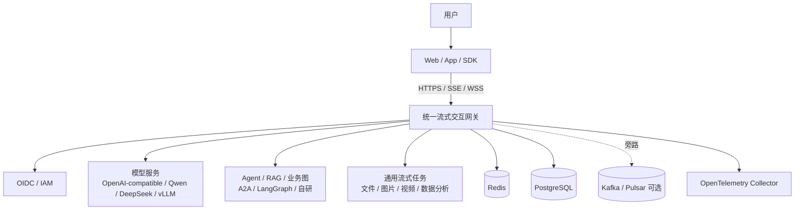
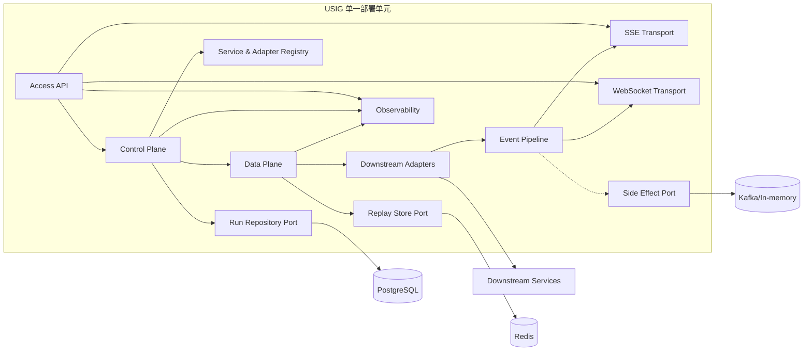
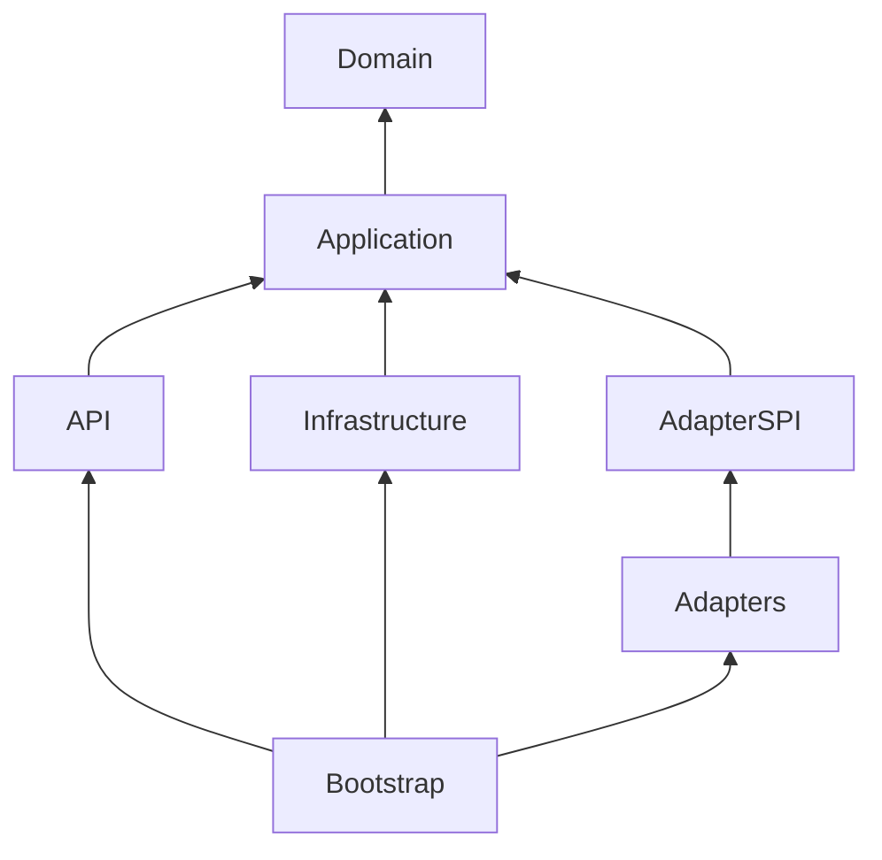
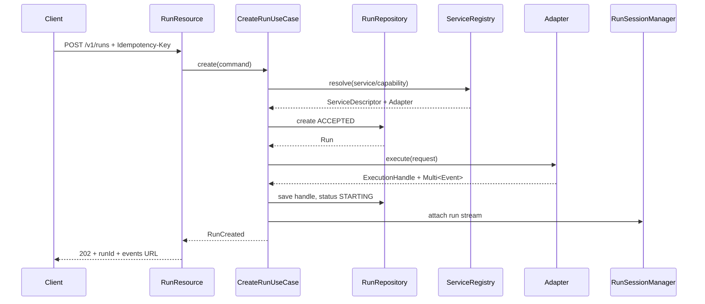
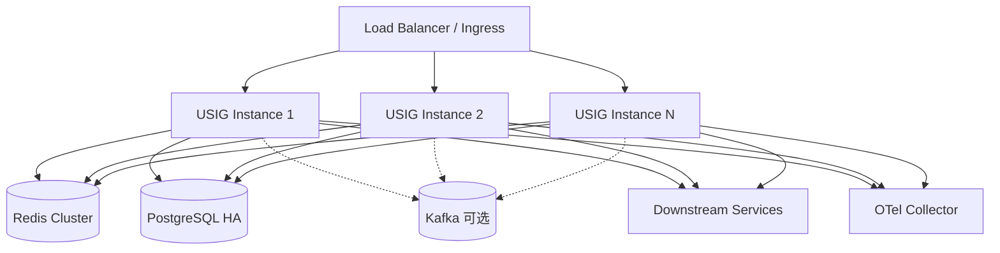

# 统一流式交互网关：架构设计文档

> 文档状态：可执行架构基线（Executable Architecture Baseline）  
> 文档日期：2026-07-27  
> 配套文档：[01-需求澄清文档.md](./01-需求澄清文档.md)  
> 首期实现：Java 21 + Quarkus 3.x 模块化单体  
> 设计目标：Codex 可以按照本文档逐阶段创建项目、搭建骨架、实现契约并运行验证，不得自行扩张系统范围

---

## 1. 架构摘要

本系统采用：

- **统一事件模型**作为核心业务抽象；
- **SSE/WebSocket/HTTP/gRPC Streaming**作为可替换传输；
- **Hexagonal Architecture（端口适配器）**隔离下游协议和基础设施；
- **Data Plane / Control Plane**职责分离；
- **Adapter Registry**连接模型、Agent、RAG、工作流和通用流式服务；
- **Composable Pipeline**执行排序、聚合、脱敏、权限和客户端投影；
- **RunSession 单写者状态机**替代一会话一线程；
- **有界缓冲、分级事件和慢客户端策略**控制资源；
- **Redis 短期状态 + PostgreSQL 持久元数据 + 可选 Kafka 旁路事件**；
- **OpenTelemetry**统一 Trace、Metrics 和 Logs；
- **契约测试、架构测试、故障注入和容量门禁**保证演进方向。

首期使用 Java/Quarkus 是工程交付决策，不是协议绑定。未来 Rust 实现必须复用相同的 OpenAPI、JSON Schema、事件语义和测试套件。

---

## 2. 架构原则

### AP-001：事件语义高于传输协议

SSE 和 WebSocket 只负责运输 `GatewayEvent`。Transport 不得理解模型 Token、工具调用或业务节点。

### AP-002：核心领域不依赖框架

`Run`、`GatewayEvent`、`ExecutionHandle`、`ServiceCapability`、`Pipeline` 接口不得依赖 Quarkus、Vert.x、Redis、Kafka 或具体 HTTP Client。

### AP-003：单 Run 有序，跨 Run 并发

同一 Run 的事件转换默认串行；不同 Run 并发处理。任何并行 Stage 都必须声明是否会改变顺序。

### AP-004：所有资源有界

连接数、活跃 Run、下游并发、队列、Replay Buffer、事件大小、重试次数、线程池和异步并发必须有上限。

### AP-005：热路径最小化

热路径仅包含：读取、解析、标准化、必要安全策略、聚合和输出。日志、审计、计费和非关键持久化通过旁路处理。

### AP-006：能力驱动，而不是类型猜测

网关通过 `ServiceDescriptor.capabilities` 决定取消、恢复、输入、图片和结构化输出能力，不根据 serviceId 硬编码。

### AP-007：失败必须显式

不支持恢复就返回不支持；补发窗口过期就返回过期；取消未生效就返回未生效。禁止用“成功”隐藏不完整状态。

### AP-008：先模块化单体，后按证据拆分

首期一个部署单元，代码模块严格隔离。只有独立扩缩容、故障域或团队边界得到数据证明后才拆微服务。

---

## 3. C4 上下文



---

## 4. 容器和组件架构



---

## 5. 模块划分

首期推荐 Maven 多模块，但保持单一可部署应用：

```text
usig/
├── pom.xml
├── AGENTS.md
├── README.md
├── docs/
│   ├── requirements-clarification.md
│   ├── architecture-design.md
│   ├── adr/
│   └── contracts/
├── usig-domain/
├── usig-application/
├── usig-adapter-spi/
├── usig-adapters/
│   ├── usig-adapter-generic-sse/
│   ├── usig-adapter-openai-compatible/
│   └── usig-adapter-sample-agent/
├── usig-infrastructure/
│   ├── usig-infra-redis/
│   ├── usig-infra-postgres/
│   ├── usig-infra-messaging/
│   └── usig-infra-observability/
├── usig-api/
├── usig-bootstrap/
└── usig-testkit/
```

如果首期团队较小，也可以使用单 Maven 模块 + 包边界；但 Codex 必须添加 ArchUnit，依赖方向不变。

### 5.1 模块职责

| 模块 | 职责 | 禁止依赖 |
|---|---|---|
| usig-domain | 领域对象、状态机、事件、错误、纯规则 | Quarkus、HTTP、Redis、Kafka、数据库 |
| usig-application | 用例、端口、Run 协调、Pipeline 编排 | 具体 Adapter、具体存储实现 |
| usig-adapter-spi | Adapter/Transport/Projection 扩展接口 | 具体下游实现 |
| usig-adapters | 下游协议适配 | 客户端 REST Resource、数据库实现 |
| usig-infrastructure | Redis、PG、消息、OTel 实现 | 反向依赖 API |
| usig-api | REST/SSE/WebSocket DTO 与端点 | 下游私有协议 |
| usig-bootstrap | Quarkus 启动、依赖装配、配置 | 领域业务实现 |
| usig-testkit | 模拟 SSE/WS 下游、契约测试、负载工具 | 生产业务逻辑 |

### 5.2 依赖方向



任何反向箭头都必须被 ArchUnit 阻止。

---

## 6. 核心领域模型

## 6.1 GatewayEvent

建议 Java 定义：

```java
public record GatewayEvent(
        String schemaVersion,
        String eventId,
        EventType eventType,
        String conversationId,
        String runId,
        String taskId,
        String sourceService,
        String sourceEventId,
        long sequence,
        Instant occurredAt,
        Instant observedAt,
        JsonNode payload,
        EventMetadata metadata
) {}
```

规则：

- 领域模块可使用 Jackson `JsonNode` 会造成框架依赖；更严格方案是自有 `EventPayload` sealed interface。首期建议使用 `Map<String,Object>` 或小型 payload 类型，API 层负责 JSON；
- `eventId` 使用 UUIDv7/ULID 等可排序唯一 ID；
- `sequence` 由 RunSession 分配；
- `occurredAt` 来自下游，缺失时可等于 observedAt；
- `observedAt` 由网关记录；
- `emittedAt` 不放入核心事件，可作为内部 DeliveryObservation。

### 6.2 EventType

```java
public enum EventType {
    EXECUTION_ACCEPTED,
    EXECUTION_STARTED,
    EXECUTION_RUNNING,
    EXECUTION_COMPLETED,
    EXECUTION_FAILED,
    EXECUTION_CANCEL_REQUESTED,
    EXECUTION_CANCELED,
    TEXT_START,
    TEXT_DELTA,
    TEXT_END,
    TOOL_START,
    TOOL_ARGUMENTS_DELTA,
    TOOL_RESULT,
    TOOL_ERROR,
    TOOL_END,
    ARTIFACT_CREATED,
    ARTIFACT_UPDATED,
    ARTIFACT_COMPLETED,
    INPUT_REQUIRED,
    APPROVAL_REQUIRED,
    PROGRESS_UPDATED,
    USAGE_UPDATED,
    WARNING,
    HEARTBEAT,
    EXTENSION
}
```

对外序列化使用小写点分格式，例如 `TEXT_DELTA → text.delta`。

### 6.3 Run

```java
public record Run(
        RunId id,
        ConversationId conversationId,
        TenantId tenantId,
        String serviceId,
        RunStatus status,
        ExecutionHandle executionHandle,
        long version,
        Instant createdAt,
        Instant updatedAt
) {}
```

### 6.4 RunStatus

```text
ACCEPTED
STARTING
RUNNING
WAITING_INPUT
CANCEL_REQUESTED
COMPLETED
FAILED
CANCELED
UNKNOWN
```

允许转换必须由纯领域函数验证，非法转换抛出 `InvalidRunTransition`。

### 6.5 ExecutionHandle

```java
public record ExecutionHandle(
        String serviceId,
        String adapterId,
        String downstreamTaskId,
        String downstreamThreadId,
        String downstreamRunId,
        Map<String, String> opaqueAttributes
) {}
```

`opaqueAttributes` 必须限制键和值长度，不允许存储凭证或正文。

---

## 7. 端口与接口

## 7.1 StreamingServiceAdapter

```java
public interface StreamingServiceAdapter {

    String adapterId();

    boolean supports(ServiceDescriptor service);

    AdapterExecution execute(
            GatewayRequest request,
            ExecutionContext context
    );

    Uni<Void> cancel(
            ExecutionHandle handle,
            ExecutionContext context
    );

    Multi<GatewayEvent> resume(
            ExecutionHandle handle,
            StreamCursor cursor,
            ExecutionContext context
    );

    Uni<DownstreamExecutionState> queryState(
            ExecutionHandle handle,
            ExecutionContext context
    );
}
```

```java
public record AdapterExecution(
        ExecutionHandle handle,
        Multi<GatewayEvent> events
) {}
```

注意：如果不希望 SPI 绑定 Mutiny，可在 SPI 使用 Reactive Streams `Publisher<GatewayEvent>` 和 `CompletionStage`，Quarkus 实现层转换为 Multi/Uni。为了未来 Rust 跨语言，更重要的是 JSON/OpenAPI 契约而不是 Java SPI 二进制兼容。

## 7.2 Pipeline Stage

```java
public interface EventStage {

    String name();

    StageCharacteristics characteristics();

    Multi<GatewayEvent> apply(
            Multi<GatewayEvent> upstream,
            PipelineContext context
    );
}
```

```java
public record StageCharacteristics(
        boolean blocking,
        boolean preservesOrder,
        boolean mayDropEvents,
        Duration timeout
) {}
```

## 7.3 Repository Ports

```java
public interface RunRepository {
    Uni<Run> create(Run run, String idempotencyKey);
    Uni<Optional<Run>> find(RunId id, TenantId tenantId);
    Uni<Run> compareAndSetStatus(RunId id, long version, RunStatus next);
    Uni<Void> saveExecutionHandle(RunId id, ExecutionHandle handle);
}

public interface ReplayStore {
    Uni<Void> append(RunId runId, GatewayEvent event, Duration ttl);
    Multi<GatewayEvent> readAfter(RunId runId, String lastEventId);
    Uni<Void> delete(RunId runId);
}

public interface SideEventPublisher {
    Uni<Void> publish(SideEvent event);
}
```

---

## 8. Control Plane

Control Plane 负责：

- 身份和租户校验；
- 创建 Conversation/Run；
- 幂等；
- 服务路由和能力验证；
- 创建下游执行；
- 保存 ExecutionHandle；
- 查询状态；
- 取消；
- 接收补充输入；
- 恢复策略决策。

### 8.1 创建 Run 流程



关键规则：

- HTTP 请求不等待完整模型输出；
- Adapter 建连可以同步返回失败，也可在流内发送 failure；
- Run 创建和下游启动之间必须定义补偿：下游启动失败则 Run → FAILED；
- 如果下游已启动但保存 Handle 失败，必须记录孤儿执行并触发补偿/查询，不能静默丢失。

---

## 9. Data Plane

Data Plane 是从下游事件到客户端事件的热路径：

```text
Downstream Raw Frames
→ Transport Decoder
→ Adapter Parser
→ GatewayEvent
→ Sequence Stage
→ Coalescing Stage
→ Redaction Stage
→ Policy Stage
→ Replay Tap
→ Client Projection
→ SSE / WebSocket Encoder
```

### 9.1 推荐 Pipeline 顺序

1. `SchemaValidationStage`：验证 Adapter 事件；
2. `TimestampNormalizationStage`；
3. `SequenceStage`：单 Run 单写者分配 sequence；
4. `ChunkCoalescingStage`：聚合小 delta；
5. `RollingRedactionStage`：跨 Chunk 脱敏；
6. `TenantPolicyStage`：reasoning、tool、artifact 可见性；
7. `CriticalEventGuardStage`：保护终止和关键事件；
8. `ReplayStage`：写短期缓冲；
9. `SideEffectTapStage`：非阻塞旁路；
10. `ClientProjectionStage`；
11. `DeliveryMetricsStage`。

### 9.2 顺序与异步处理

- 对同一 Run，使用 `transformToUniAndConcatenate` 或等价串行操作确保顺序；
- 只有明确无顺序影响的旁路操作可以并行；
- 不要在每个事件上随意 `emitOn`；Mutiny 官方提醒线程切换可能引入并发问题并破坏 Reactive Streams 语义；
- 订阅时阻塞操作用 `runSubscriptionOn`，每事件阻塞调用用受限 `emitOn` 或专用 worker，但首选改成异步客户端；
- 永远不要使用无限 merge 并发处理外部调用。

---

## 10. RunSession 设计

`RunSession` 是逻辑状态机，不是线程：

```java
final class RunSession {
    private final RunId runId;
    private final AtomicLong sequence;
    private final CancellationToken cancellationToken;
    private final BoundedEventBuffer buffer;
    private final RedactionWindow redactionWindow;
    private final SubscriberRegistry subscribers;
    private volatile RunStatus status;
}
```

推荐保证单写者：

1. 每个下游流天然顺序发出；
2. Pipeline 不并行修改 RunSession；
3. 控制命令通过串行 mailbox 或状态 CAS 进入；
4. 连接订阅者集合可以并发，但事件序号和生命周期只由 RunCoordinator 修改。

### 10.1 不允许的实现

```java
// 禁止：一个虚拟线程中执行所有事情
while (downstream.hasNext()) {
    var chunk = downstream.next();
    redis.set(...);
    database.save(...);
    audit.call(...);
    client.write(...);
}
```

### 10.2 推荐实现形态

```java
Multi<GatewayEvent> stream = adapterExecution.events()
    .plug(events -> pipeline.apply(events, context))
    .onCancellation().invoke(() -> session.onSubscriberCancelled())
    .onFailure().invoke(session::onFailure)
    .onCompletion().invoke(session::onCompletion);
```

框架负责订阅；应用代码不得为每个 Run 创建手写读取线程。

---

## 11. SSE 设计

### 11.1 API

```http
GET /v1/runs/{runId}/events
Accept: text/event-stream
Last-Event-ID: evt_...
Authorization: Bearer ...
```

响应：

```text
id: evt_01J...
event: text.delta
data: {"schemaVersion":"1.0","runId":"run_...","sequence":12,"payload":{"content":"你好"}}

```

### 11.2 Quarkus 端点建议

```java
@Path("/v1/runs")
@Produces(MediaType.SERVER_SENT_EVENTS)
public class RunEventResource {

    @GET
    @Path("/{runId}/events")
    @RestStreamElementType(MediaType.APPLICATION_JSON)
    public Multi<OutboundSseEventDto> events(
            @PathParam("runId") String runId,
            @HeaderParam("Last-Event-ID") String lastEventId
    ) {
        return subscribeRunEvents.execute(runId, lastEventId);
    }
}
```

最终编码需确认 Quarkus `RestMulti`/SSE 类型对 `id` 和 `event` 字段的支持；若默认 JSON streaming 无法设置 SSE id/event，必须使用 Quarkus 支持的 SSE event 类型或底层 Vert.x 响应封装，但不得把业务逻辑下沉到 Resource。

### 11.3 心跳

- 默认 15 秒；
- 心跳不写永久存储；
- Replay Buffer 可忽略心跳；
- 心跳不能重置总执行超时，只重置网络空闲检测。

### 11.4 代理和部署

必须验证：

- Nginx/Ingress 禁止响应缓冲；
- idle timeout 大于心跳间隔至少 2 倍；
- HTTP/2 和连接复用行为；
- 负载均衡器排空策略；
- 压缩是否造成延迟聚合；对小型 delta 默认可关闭压缩或按阈值启用。

---

## 12. WebSocket 设计

WebSocket 用于：

- 同连接多次输入；
- 实时语音/音频帧；
- Human-in-the-loop；
- 多 Run 复用；
- 双向控制和状态同步。

### 12.1 子协议

```text
Sec-WebSocket-Protocol: usig.events.v1
```

### 12.2 消息类型

客户端到服务端：

```json
{
  "type": "command.cancel",
  "commandId": "cmd_01",
  "runId": "run_01"
}
```

```json
{
  "type": "command.input",
  "commandId": "cmd_02",
  "runId": "run_01",
  "payload": {"answer": "批准"}
}
```

服务端到客户端仍为 GatewayEvent，控制命令响应使用：

```json
{
  "type": "command.result",
  "commandId": "cmd_02",
  "accepted": true
}
```

### 12.3 Quarkus WebSockets Next

使用 `quarkus-websockets-next`，理由：官方文档说明其与 Quarkus Reactive 网络层集成，并支持非阻塞 `Uni/Multi`。必须：

- 在 endpoint class 上配置认证；
- 限制 Origin；
- 使用 WSS；
- 设置 max-frame-size、max-message-size；
- 配置 auto-ping；
- 禁止记录凭证消息；
- Endpoint 共享实例必须无状态或线程安全。

---

## 13. 下游 Adapter 设计

## 13.1 Generic SSE JSON Adapter

用途：为已有 SSE 服务快速接入，但必须通过映射配置将下游事件转换成有限的 GatewayEvent。

配置示例：

```yaml
services:
  document-parser:
    adapter: generic-sse-json-v1
    endpoint: https://internal.example/parser/run
    allow-hosts: [internal.example]
    mapping-profile: document-parser-v1
    capabilities:
      streaming: true
      cancel: false
      resume: false
```

映射不能允许任意脚本。首期只支持：

- JSON Pointer 取值；
- 固定字段映射；
- 枚举映射；
- 默认值；
- 简单字符串模板；
- 白名单事件类型。

复杂业务映射必须写专用 Adapter。

## 13.2 OpenAI-compatible Adapter

负责：

- 统一多模态请求 → Chat/Responses 兼容请求；
- 解析 `data:`；
- `[DONE]`；
- 文本 delta；
- reasoning（若服务提供）；
- tool calls；
- usage；
- 下游错误。

它只是一个 Adapter，不应让核心事件模型退化成 OpenAI choices/delta。

## 13.3 Agent Adapter

应参考 A2A 的 Task/Message/Artifact/Status 思想：

- 保存下游 taskId；
- 将 task 状态转为 execution.*；
- 将 Message Part 转为 text/artifact；
- 将等待用户输入转为 input.required；
- 支持 query/cancel/resubscribe 时使用能力声明。

AG-UI 可以作为客户端 Projection 参考，不要求网关内部事件与 AG-UI 完全一一对应。

---

## 14. 背压、缓冲和慢客户端

### 14.1 三层缓冲

| 层 | 目的 | 默认限制 |
|---|---|---|
| Downstream decoder buffer | 处理网络分片和帧 | 256 KiB/frame，按 Adapter 配置 |
| Run pending buffer | 解耦短暂处理抖动 | 256 events 或 1 MiB，先到者为准 |
| Replay buffer | 断线补发 | 10 分钟，单 Run 8 MiB，按租户限额 |

具体数值是初始默认，必须配置化并通过压测调整。

### 14.2 溢出策略

优先级：

1. 合并连续 `text.delta`；
2. 覆盖旧 `progress.updated`；
3. 丢弃 heartbeat/typing；
4. 暂停下游读取（若 Reactive Streams 能传递需求）；
5. 将客户端转为后台任务并断开；
6. 返回 `client_too_slow` 并关闭连接。

关键终止事件不得因普通 buffer 满而静默丢失；可保留独立的少量 control slot。

### 14.3 Mutiny 注意事项

Mutiny `UnicastProcessor` 默认使用无界队列，因此禁止直接采用默认构造用于生产 Run Buffer；必须提供固定大小队列或使用自建有界缓冲。Mutiny 的 `paceDemand`、合并/串行操作可以用于控制需求，但必须通过压力测试验证。

---

## 15. 跨 Chunk 脱敏

模型和服务可能把敏感串拆成多个 delta，因此不能逐 Chunk 独立替换。

### 15.1 Rolling Window 算法

1. 保留末尾 N 个字符不立即输出；
2. 将新 delta 与保留区拼接；
3. 执行规则/自动机/正则扫描；
4. 输出已确认安全的前缀；
5. 将可能跨边界的尾部继续保留；
6. text.end 时 flush 并执行最终检查。

`N` 至少覆盖最长固定敏感模式减 1；对不定长规则需设计最大扫描窗口或使用流式 DFA。

### 15.2 安全要求

- 原始敏感正文不得进入普通日志；
- 旁路事件默认发送脱敏后文本；
- 审计保留原文必须使用独立加密、权限和保留策略；
- 脱敏超时或异常的默认策略应为 fail-closed 或租户可配置，不能无声跳过。

---

## 16. 持久化设计

## 16.1 PostgreSQL

建议表：

```sql
create table runs (
  run_id varchar(64) primary key,
  conversation_id varchar(64) not null,
  tenant_id varchar(64) not null,
  user_id varchar(128),
  service_id varchar(128) not null,
  adapter_id varchar(128) not null,
  status varchar(32) not null,
  execution_handle jsonb,
  idempotency_key varchar(128),
  version bigint not null,
  created_at timestamptz not null,
  updated_at timestamptz not null,
  completed_at timestamptz,
  error_code varchar(128),
  result_summary jsonb
);

create unique index uk_runs_idempotency
  on runs(tenant_id, idempotency_key)
  where idempotency_key is not null;
```

首期不建议将所有 GatewayEvent 存入 PostgreSQL。

## 16.2 Redis

键建议：

```text
usig:run:{runId}:runtime       HASH，TTL
usig:run:{runId}:events        STREAM 或有界结构，TTL
usig:tenant:{tenantId}:usage   counters
usig:service:{serviceId}:load  counters
```

规则：

- Redis 不是唯一事实来源；
- 不得每个 Token 同步更新多个 Key；
- Replay 写入可批量/流水线；
- 达到 Replay 上限时按事件策略压缩，不得无限增长。

## 16.3 Kafka/旁路

Topic 建议：

```text
usig.run.lifecycle.v1
usig.message.persist.v1
usig.audit.v1
usig.usage.v1
```

Key 使用 runId，以维持单 Run 分区顺序。消费者必须幂等，eventId 为去重键。

---

## 17. 超时、重试、熔断和隔离

每个 ServiceDescriptor 配置：

```yaml
timeouts:
  connect: 3s
  first-event: 30s
  idle-event: 60s
  total-run: 20m
  cancel: 5s
retry:
  connect-attempts: 2
  resume-attempts: 3
limits:
  max-concurrent-runs: 500
  max-frame-bytes: 262144
  max-event-rate: 100
```

策略：

- 建连前且请求幂等：可重试；
- 收到首个业务事件后：不得自动重建新的 Run；
- 下游支持 resume：从 source cursor 续订；
- 下游不支持：结束为 `downstream_stream_interrupted`；
- 熔断按 serviceId 隔离；
- 并发信号量按租户和服务双层限制；
- 重试必须带 jitter，禁止同步重试风暴。

---

## 18. 错误模型

统一错误：

```json
{
  "code": "DOWNSTREAM_FIRST_EVENT_TIMEOUT",
  "message": "下游服务未在规定时间内产生首个事件",
  "retryable": true,
  "runId": "run_01",
  "serviceId": "finance-agent",
  "details": {
    "timeoutMs": 30000
  }
}
```

P0 错误码：

```text
INVALID_REQUEST
UNAUTHORIZED
FORBIDDEN
TENANT_LIMIT_EXCEEDED
SERVICE_NOT_FOUND
SERVICE_CAPABILITY_UNSUPPORTED
ADAPTER_NOT_FOUND
DOWNSTREAM_CONNECT_FAILED
DOWNSTREAM_FIRST_EVENT_TIMEOUT
DOWNSTREAM_IDLE_TIMEOUT
DOWNSTREAM_STREAM_INTERRUPTED
DOWNSTREAM_PROTOCOL_ERROR
EVENT_TOO_LARGE
BUFFER_OVERFLOW
CLIENT_TOO_SLOW
RUN_NOT_FOUND
RUN_ALREADY_TERMINAL
CANCEL_NOT_SUPPORTED
RESUME_NOT_SUPPORTED
CURSOR_EXPIRED
REDACTION_FAILED
INTERNAL_ERROR
```

错误 message 不得包含下游响应正文、密钥或堆栈。

---

## 19. 安全架构

### 19.1 入站

- OIDC/JWT；
- tenantId 从可信 Claim 获取，不信任客户端自报；
- RBAC/ABAC 校验 serviceId；
- Idempotency-Key 限长；
- 请求体、图片数量、URL、MIME、大小限制；
- WebSocket Origin allowlist。

### 19.2 出站

- 仅允许注册表中的 endpoint；
- DNS/IP 检查防 SSRF；
- 禁止访问 link-local、metadata、loopback（除非显式内部白名单）；
- 下游凭证按 serviceId 从 Secret Store 获取；
- TLS 校验和可选 mTLS；
- 请求头白名单转发，禁止透传所有客户端 Header。

### 19.3 数据

- 敏感字段不得进入 Metrics；
- 结构化日志中正文默认只记录长度和 hash；
- PostgreSQL/Redis 访问启用 TLS（生产）；
- Run 查询必须使用 `(tenantId, runId)`；
- Replay 数据加密和 TTL；
- 数据保留策略由租户配置。

---

## 20. 可观测性

### 20.1 Trace

Span 建议：

```text
usig.run
├── usig.service.resolve
├── usig.adapter.execute
│   └── http.client downstream
├── usig.pipeline
│   ├── usig.stage.redaction（采样或聚合）
│   └── usig.stage.projection
├── usig.replay.append
└── usig.side.publish
```

不要为每个 text.delta 都创建 Span；使用 Metrics 或 Span Event，避免遥测放大。

### 20.2 Metrics

低基数标签：

```text
service_id（受控集合）
adapter_id（受控集合）
event_type（枚举）
result（success/failure/canceled）
transport（sse/websocket）
error_code（受控枚举）
```

禁止标签：runId、conversationId、userId、URL、正文。

### 20.3 Logs

统一字段：

```json
{
  "timestamp": "...",
  "level": "INFO",
  "event": "run_completed",
  "traceId": "...",
  "spanId": "...",
  "runId": "...",
  "tenantId": "...",
  "serviceId": "...",
  "durationMs": 1234,
  "result": "completed"
}
```

---

## 21. 部署架构



### 21.1 粘性

首期 SSE 活跃连接天然停留在建立它的实例。重连可以落到其他实例，通过 Redis Replay/Run 元数据恢复，因此不应依赖永久粘性。WebSocket 多 Run 连接同样只在连接生命周期内本地持有。

### 21.2 优雅排空

实例进入 draining：

1. readiness 变为 false；
2. 拒绝新 Run/新连接；
3. 现有连接继续至最大排空时间；
4. 向支持恢复的客户端发送 `warning: server_draining`；
5. 到期后关闭连接，客户端重连；
6. 不自动取消继续运行的下游 Task。

---

## 22. 测试架构

## 22.1 单元测试

- Run 状态机；
- sequence；
- Chunk 合并；
- Rolling Redaction；
- 错误映射；
- 能力验证；
- 溢出策略。

## 22.2 Adapter 契约测试

统一 TestKit 向每个 Adapter 发送：

- SSE 分片；
- 多行 data；
- 注释心跳；
- 非法 UTF-8；
- 半个 JSON 后断开；
- 超大帧；
- 业务错误；
- 首事件超时；
- idle timeout；
- cancel；
- resume。

## 22.3 集成测试

使用 Testcontainers：

- PostgreSQL；
- Redis；
- Kafka（启用时）；
- WireMock/MockServer 或自研 SSE 下游模拟器。

## 22.4 架构测试

ArchUnit 规则：

```text
domain 不依赖 quarkus/vertx/redis/kafka/jakarta.ws.rs
application 不依赖 adapters/infrastructure/api
adapters 不依赖 api
transport 不依赖下游具体 DTO
任何名称包含 *Resource 的类只存在于 api
```

## 22.5 性能测试

建议 Gatling/k6：

- 10,000 idle SSE；
- 2,000 active × 10 event/s；
- 1% 慢客户端；
- 频繁断线重连；
- 大量小 delta 与合并前后对比；
- Redis 故障；
- 下游抖动和断流；
- 滚动发布排空。

必须收集：CPU、RSS/Heap、GC、Event Loop 阻塞、连接数、buffer bytes、P50/P95/P99 added latency。

---

## 23. Codex 项目搭建阶段

Codex 应按以下顺序执行。每个阶段单独任务、单独提交、测试通过后进入下一阶段。

### Phase 0：仓库控制文件

交付：

- 根 `AGENTS.md`；
- 两份设计文档进入 `docs/`；
- ADR 模板；
- Checkstyle/Spotless；
- Maven Wrapper；
- CI 骨架。

禁止：写业务代码。

### Phase 1：领域和契约

交付：

- `GatewayEvent`；
- `Run`、`RunStatus` 状态机；
- `ServiceDescriptor` 和能力；
- 错误码；
- JSON Schema；
- 单元测试。

禁止：REST、Redis、下游 HTTP。

### Phase 2：端口与应用用例

交付：

- Adapter SPI；
- Repository Ports；
- CreateRun/GetRun/CancelRun/SubscribeRunEvents；
- In-memory 实现；
- 状态和幂等测试。

### Phase 3：SSE 最小垂直切片

交付：

- Quarkus Bootstrap；
- `POST /v1/runs`；
- `GET /events`；
- Sample Adapter；
- 基础 Pipeline；
- 端到端测试。

完成定义：从模拟下游收到事件并按统一协议输出。

### Phase 4：Generic SSE Adapter

交付：

- 下游 SSE Decoder；
- 受限映射配置；
- 帧限制；
- 契约测试；
- 取消和超时。

### Phase 5：可靠性

交付：

- 有界 Buffer；
- Chunk Coalescing；
- Rolling Redaction；
- Last-Event-ID；
- Redis Replay；
- 慢客户端策略；
- 故障注入测试。

### Phase 6：持久化与旁路

交付：

- PostgreSQL RunRepository；
- Outbox 或 SideEventPublisher；
- Kafka 可选实现；
- OpenTelemetry。

### Phase 7：WebSocket

前提：SSE 性能和可靠性门禁通过。

交付：

- `usig.events.v1`；
- command.cancel/input；
- 鉴权续期；
- Origin/WSS/帧限制；
- 多 Run 连接测试。

### Phase 8：生产压测与 Rust 决策

- 固定同一协议、Adapter 模拟器和压测脚本；
- 测量 Quarkus；
- 仅当内存/尾延迟是主要瓶颈时，建立 Rust/Axum 数据平面 PoC；
- Rust 不得重新定义事件和 API。

---

## 24. 推荐 `AGENTS.md` 基线

```markdown
# Project instructions

## Source of truth
- Read docs/requirements-clarification.md and docs/architecture-design.md before changing code.
- Requirements override implementation convenience.
- Architecture changes require an ADR in docs/adr/.

## Mandatory architecture rules
- Core domain must not depend on Quarkus, Vert.x, Redis, Kafka, REST DTOs, or downstream SDKs.
- All downstream integrations use StreamingServiceAdapter.
- All client streaming data uses GatewayEvent after pipeline processing.
- No unbounded queues, buffers, retries, concurrency, or thread creation.
- Never block an event-loop thread.
- Per-run event order must be preserved.
- Side effects must not block text streaming unless explicitly marked critical.
- Do not add business graph, prompt, RAG, or model-specific logic to the gateway core.

## Workflow
- Implement one phase/task at a time.
- Add tests before or with code.
- Run ./mvnw verify before completion.
- Report changed files, tests executed, assumptions, and remaining risks.
- Do not add infrastructure or dependencies not requested by the current task.

## Forbidden shortcuts
- No raw downstream SSE/WebSocket frames sent to clients.
- No serviceId if/else chains in core runtime.
- No synchronous Redis/DB write for every token.
- No sensitive content in logs, traces, or metric labels.
```

---

## 25. 初始依赖建议

项目初始化时通过 Quarkus BOM 固定版本，不在各模块单独指定版本。

首期依赖候选：

```text
quarkus-rest-jackson
quarkus-rest-client-jackson
quarkus-rest-client
quarkus-websockets-next（P1，可先不加入）
quarkus-redis-client
quarkus-jdbc-postgresql 或 reactive-pg-client（二选一，推荐 reactive）
quarkus-hibernate-reactive-panache（只有确定需要 ORM 时）
quarkus-messaging-kafka（Phase 6）
quarkus-opentelemetry
quarkus-micrometer-registry-prometheus
quarkus-smallrye-health
quarkus-smallrye-openapi
quarkus-oidc
resilience4j 或 SmallRye Fault Tolerance（评估后只选一种）
archunit-junit5
testcontainers
awaitility
```

不得在 Phase 1 一次性加入全部依赖。按阶段最小化引入。

---

## 26. 架构决策记录清单

项目初始化时创建：

```text
ADR-0001 选择模块化单体
ADR-0002 统一 GatewayEvent 而非下游协议透传
ADR-0003 SSE 默认、WebSocket 条件使用
ADR-0004 至少一次重放和 eventId 去重
ADR-0005 Redis 短期重放、PostgreSQL 持久元数据
ADR-0006 热路径副作用旁路化
ADR-0007 Java/Quarkus 首期，Rust 延后评估
ADR-0008 不在网关内承载业务图
```

---

## 27. 代码评审检查表

每个 PR 必须回答：

- [ ] 是否改变了事件语义或状态机？有 ADR 吗？
- [ ] 是否新增无界集合、队列、线程池或并发？
- [ ] 是否可能阻塞 Event Loop？
- [ ] 是否保持单 Run 顺序？
- [ ] 是否把下游私有 DTO 泄露到核心/API？
- [ ] 是否把客户端格式写入 Adapter？
- [ ] 是否添加 serviceId 分支？
- [ ] 是否给缓冲、超时、重试和大小设置上限？
- [ ] 是否考虑慢客户端和取消？
- [ ] 是否记录敏感正文？
- [ ] 是否添加了测试和可观测性？
- [ ] 是否完成资源清理和订阅取消？

---

## 28. 参考来源

1. AG-UI：事件驱动的 Agent-UI 协议；传输可使用 SSE、WebSocket 等：  
   https://github.com/ag-ui-protocol/ag-ui
2. A2A：独立 Agent 的能力发现、任务生命周期、SSE 流、REST/gRPC/JSON-RPC 绑定：  
   https://github.com/a2aproject/A2A  
   https://github.com/a2aproject/A2A/blob/main/docs/specification.md
3. CloudEvents：统一事件上下文和事件/消息/协议绑定分层：  
   https://github.com/cloudevents/spec
4. Quarkus REST 与 SSE：  
   https://quarkus.io/guides/rest
5. Quarkus WebSockets Next：  
   https://quarkus.io/guides/websockets-next-reference
6. SmallRye Mutiny：Multi/Uni、线程边界、需求控制和有界队列：  
   https://smallrye.io/smallrye-mutiny/latest/
7. Quarkus Messaging：消息旁路、顺序、并发、Kafka 和 OpenTelemetry：  
   https://quarkus.io/guides/messaging  
   https://quarkus.io/guides/kafka
8. OpenTelemetry：Trace、Metric、Log 信号：  
   https://opentelemetry.io/docs/concepts/signals/
9. Codex `AGENTS.md` 指导：  
   https://openai.com/index/introducing-codex/

---

## 29. 最终约束

无论 Codex、人工开发或未来 Rust 重写，都必须满足：

1. 对外 API 与 GatewayEvent 契约优先于实现；
2. SSE/WebSocket 是 Transport，不是领域模型；
3. Adapter 隔离下游差异；
4. Pipeline 隔离横切策略；
5. RunSession 不等于线程；
6. 所有资源有界；
7. 主流式链路不承担非关键同步副作用；
8. 网关不执行下游业务图；
9. 恢复和取消能力必须真实可验证；
10. 没有压测证据，不因语言偏好进行全量重写。
